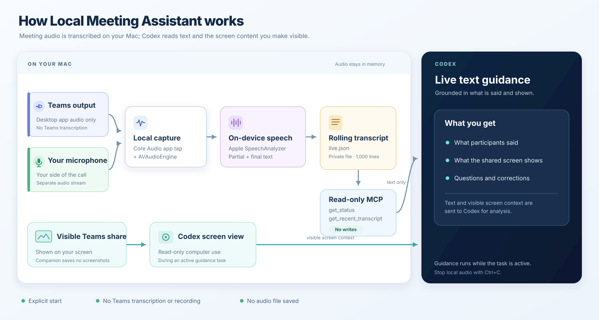

# Meeting Assistant

Meeting Assistant is an **alpha macOS source build** for Microsoft Teams
meetings. It captures Teams output audio and your microphone, transcribes both
streams with Apple's on-device speech framework, and gives Codex a read-only
view of the rolling text. Codex can also inspect a visible screen share with
its separate computer-use tool and provide short guidance while you keep the
chat task active.



This is an independent project and is not affiliated with Microsoft or OpenAI.
It does not turn on Teams' built-in recording or transcription.

## Requirements

- macOS 26 or newer with a Swift 6.2 or newer command-line toolchain
- The Microsoft Teams desktop app; Teams in a browser is not supported
- Microphone and System Audio Recording permission for Meeting Assistant
- Codex with computer-use access to inspect a visible screen share

## Build and run

From the repository root:

```sh
./scripts/build-app.sh
./dist/MeetingAssistant.app/Contents/MacOS/meeting-assistant start
```

The first run may download an Apple speech model and request macOS audio
permissions. Keep the command running during the meeting. Press **Ctrl+C** to
stop capture. To check its state from another terminal, run:

```sh
./dist/MeetingAssistant.app/Contents/MacOS/meeting-assistant status
```

The default speech locale is `en-GB`. Choose another Apple-supported locale
for both audio streams when needed, for example:

```sh
./dist/MeetingAssistant.app/Contents/MacOS/meeting-assistant start --locale fr-FR
```

The app captures only recognized Teams desktop app output and the current
microphone input. It does not save audio or screenshots.

## Connect Codex

Install the local plugin from the repository root:

```sh
codex plugin marketplace add "$(pwd)"
codex plugin add meeting-assistant@meeting-assistant-local
```

The plugin supplies `get_status` and `get_recent_transcript`. Both tools only
read a local JSON snapshot; neither can start capture or change Teams. If the
tools do not appear in an existing Codex chat, open a new chat or reload Codex.

After starting capture, ask Codex: **“Follow this meeting and its shared
screen.”** Codex can read new transcript lines and periodically inspect the
visible shared content. Say **“stop”** to end Codex's active checking task, and
press **Ctrl+C** in the capture terminal to stop audio capture. The plugin does
not provide autonomous background guidance after the chat task ends.

## Data and privacy

Audio buffers stay in memory. The app writes text to
`~/Library/Application Support/MeetingAssistant/live.json`, retaining the most
recent 1,000 finalized segments and replacing that history when a new session
starts. It creates the directory with mode `0700` and the snapshot with mode
`0600`. **The last transcript remains on disk after capture stops until you
delete `live.json`.** When you ask Codex to analyze a meeting, transcript text
and any screen view it inspects are sent to Codex; raw audio is not.

Check your meeting's consent requirements and your organization's policy before
capturing participant audio. Local capture is separate from Teams' built-in
controls, and [Teams policy may notify participants when third-party audio
capture is detected](https://learn.microsoft.com/en-us/powershell/module/teams/set-csteamsmeetingpolicy).
Do not assume local capture is silent to other participants.

## Current limits

- This is a macOS source build, with no Windows, Linux, or browser Teams support.
- Speech is labeled **system** (Teams output) or **mic** (you); individual remote
  speakers are not identified.
- Screen inspection requires a visible Teams share and an active Codex task.
- The first live Teams audio tap and macOS permission flow still need an
  end-to-end test. The checks below use synthetic input.

## Checks

```sh
swift run MeetingAssistantSelfTest
python3 -m unittest discover -s Tests/MeetingMCPTests -v
```

The code is available under the [MIT License](LICENSE).
